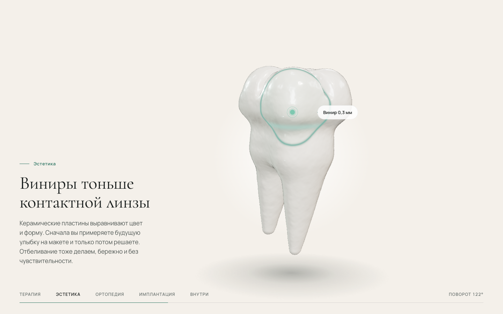

# IVORY. Демо-сайт стоматологической клиники

Демо-проект [Verto Studio](https://vertostudio.ru): лендинг вымышленной премиальной стоматологии в Москве. Главная фишка: большой 3D-зуб, который поворачивается при прокрутке и по очереди показывает услуги клиники.

**Живой сайт:** https://verto-demo-ivory.vercel.app



## Что внутри

| Секция | Что происходит |
| --- | --- |
| Hero | Буквы IVORY поднимаются из маски (чистый CSS, без ожидания JS), фон с медленными частицами на 2D canvas |
| 3D-зуб (pinned) | Зуб всплывает снизу, закрепляется и за 6 экранов прокрутки делает полный оборот 0° → 360° |
| Терапия | Сканирующее кольцо вокруг пломбы в центральной фиссуре |
| Эстетика | Контур винира на передней поверхности, по нему проходит линия скана |
| Ортопедия | Коронка зуба стачивается в культю, сверху опускается циркониевая коронка |
| Имплантация | Корни растворяются, снизу вкручивается титановый имплант |
| Эндодонтия | Единственная смена темы на странице: рентген-режим, эмаль прозрачная, светятся пульпа и каналы |
| О клинике, врачи, отзыв, контакты | Reveal-анимации строк, count-up цифр, параллакс в карточках врачей, отзыв «проявляется» по словам |

Рядом с зубом HTML-маркеры, привязанные к точкам на модели (проекция из 3D в экран каждый кадр), снизу HUD со стадиями, прогрессом и углом поворота.

## Стек

- **Vite + TypeScript**, без фреймворков
- **Three.js**: `MeshPhysicalMaterial` (clearcoat 1.0, sheen) с инъекциями в шейдер для подсветок, растворения корней и рентгена
- **GSAP 3 + ScrollTrigger + SplitText**: один scrubbed-таймлайн управляет состоянием зуба (`src/state.ts`)
- **Lenis**: smooth scroll, синхронизирован с ScrollTrigger и рендером через `gsap.ticker` (один rAF на всё)
- **Модель**: процедурная, GLB + Draco, две детализации (512 КБ desktop, 182 КБ mobile)
- Шрифты Cormorant Garamond + Manrope (Google Fonts, self-hosted через Fontsource)

## Структура

```
ivory-dental/
├── public/models/        # tooth-hi.glb, tooth-lo.glb (Draco)
├── scripts/
│   ├── gen-tooth.mjs     # генератор 3D-модели (SDF → Surface Nets → GLB + Draco)
│   └── promo.mjs         # скриншоты и вертикальное видео с виртуальным временем
├── src/
│   ├── main.ts           # точка входа, ленивая загрузка 3D, меню, форма записи
│   ├── scene.ts          # Three.js: сцена, свет, материалы, шейдеры, маркеры
│   ├── animations.ts     # GSAP-таймлайны и ScrollTrigger
│   ├── scroll.ts         # Lenis
│   ├── state.ts          # общее состояние зуба и углы стадий
│   ├── motes.ts          # частицы hero
│   └── styles/main.css
├── promo/                # скриншоты, scroll.mp4, отчёты Lighthouse
├── index.html
├── vercel.json
└── CREDITS.md
```

## Запуск

```bash
npm install
npm run dev        # http://localhost:5173
npm run build      # сборка в dist/
npm run preview    # проверка сборки, http://localhost:4173
npm run model      # пересобрать 3D-модель
```

Промо-материалы (нужен Google Chrome и запущенный `npm run preview`):

```bash
node scripts/promo.mjs screens   # promo/screens/*.png
node scripts/promo.mjs video     # promo/scroll.mp4, 1080×1920, 30 fps
```

## Производительность

Lighthouse (production build): **Mobile** 95 / 100 / 100 / 100, **Desktop** 100 / 100 / 100 / 100 (Performance / Accessibility / Best Practices / SEO). Отчёты: [`promo/lighthouse.html`](promo/lighthouse.html), [`promo/lighthouse-desktop.html`](promo/lighthouse-desktop.html).

Как этого добились:
- первый экран не зависит от JS: интро hero на CSS-анимациях;
- Three.js (160 КБ gzip) и модель грузятся отдельным чанком только после первого скролла, касания или клавиши;
- на мобильных лёгкая модель, DPR ≤ 1.5 (на desktop ≤ 2), короче pinned-секция;
- шейдеры прогреваются `compileAsync` до первого кадра, рендер останавливается, когда секция вне экрана, ресурсы GPU освобождаются на `pagehide`;
- анимации только через `transform` и `opacity`, `prefers-reduced-motion` отключает Lenis и декоративное движение.

---

Демо-проект Verto Studio · вымышленный бренд, создан для демонстрации возможностей студии.
Telegram [@Verto_Studio](https://t.me/Verto_Studio) · [vertostudio.ru](https://vertostudio.ru)
